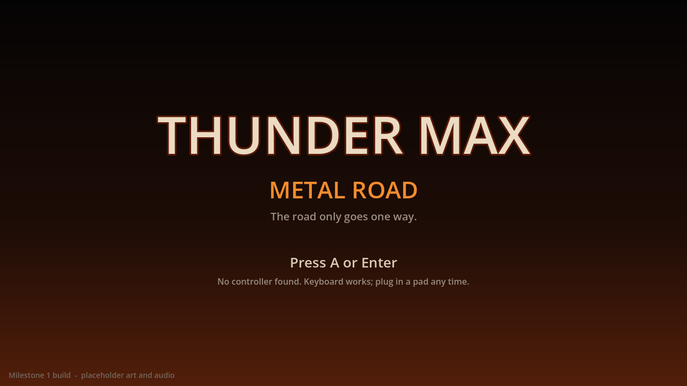

# Thunder Max: Metal Road

An original vehicular-combat arena game: dark, serious, with a little dark humor.
Built in Godot 4, structured so the game rules and data can move to Unreal later.

This build is **Milestone 1 (first playable)** plus the first part of **Milestone 2 (core
combat)**: one car, one arena, the machine gun, D-pad combo moves with an energy meter, pickup
special weapons, drones that fight back, Xbox controller support, and the arcade handling model
with a live tuning panel. All art and audio are placeholders made in code.



## Run it

1. Install **Godot 4.7** (standard build, not .NET) from <https://godotengine.org/download>.
2. Open Godot, choose **Import**, and select this folder's `project.godot`.
3. Plug in your Xbox controller (USB or Bluetooth), then press **F5** (or the Play button).

To skip the editor, run the game directly:
`Godot_v4.7.2-stable_win64.exe --path "C:\path\to\ThunderMax"` (a `.bat` file with that line
works as a desktop shortcut).

Press **A** or **Enter** on the title screen. You start in the Foundry Yard in Rustjaw, with
three Scrap Drones running laps. Get close and they turn on you. Wreck them, grab pickups and
weapon crates, set off the fuel drums.

## Controls

Two pad layouts; switch between them in the pause menu. Your choice is saved.
Every action can also be remapped (see **Remapping** below); the table shows the defaults.

| Action | Modern (default) | Classic | Keyboard |
| --- | --- | --- | --- |
| Accelerate | RT | A | W / Up |
| Brake, then reverse | LT | X | S / Down |
| Steer | Left stick | D-pad or left stick | A, D / Left, Right |
| Machine gun | RB | B | Space |
| Special weapon | X | Y | F |
| Turbo | A | LT | Shift |
| Look back | B | RT | C |
| Previous / next special | LB / Y | LB / RB | Q / E |
| Combo moves | D-pad | D-pad | I, K, J, L (up, down, left, right) |
| Pause | Menu | Menu | Esc |
| Handling tuning panel | View | View | F1 |
| Debug readout | | | F3 |
| Fullscreen | | | F11 |

**Classic** puts the driving on the face buttons the way 1990s pads did, and D-pad steering
ramps in over a fraction of a second instead of snapping to full lock. **Modern** uses the
analog triggers for throttle and brake.

**Power slide:** hold brake and steer at speed. A dedicated drift control is planned for a
later milestone.

### Combo moves

Tap a D-pad sequence quickly (each press within about half a second of the last). Each move
costs combo energy (the ENERGY bar at the bottom of the status panel), which refills on its own. The notches on the bar
are 25 energy apart. Your presses show as arrows at the bottom of the screen while you enter
them, and the pause menu lists every move.

| Move | Inputs | Energy | What it does |
| --- | --- | --- | --- |
| Spring Jack | Down, Down, Up | 25 | Hydraulic rams kick the car into the air. Hop walls, dodge mines. |
| Bulwark | Left, Right, Down | 50 | Welded plates slam shut: no damage for 3 seconds. Puts out fire and thaws ice. |
| Cold Snap | Right, Left, Up | 35 | A coolant round that freezes the car it hits for about 2 seconds. Aims at your lock-on target. |
| Scrap Mine | Up, Up, Down | 25 | Drops a spiked charge behind you. Blows up the next car to touch it (three out at a time). |
| Fire Jug | Up, Down, Up | 35 | Lobs a jug of fuel ahead that leaves a burning pool. Cars in it catch fire. |

A frozen car can't drive, fire specials or use combos. Spring Jack only works on the ground.
The combo directions are their own actions (Combo up/down/left/right), so they can be remapped
like everything else. In the Classic layout the D-pad also steers; only the exact sequences
above fire a move, and every one ends on a direction that steering doesn't use.

Names, inputs, costs and effects all live in `data/combos.json`.

### Special weapons

Weapon crates (yellow band) give two shots of a random special. Hold up to six of each, switch
with previous / next special, and fire with the special button.

| Special | What it does |
| --- | --- |
| Seeker | Homing missile; follows your lock-on target. |
| Firebrand | Fast incendiary round; sets the target alight. |
| Sledge | Slow, heavy rocket that fires straight and shoves what it hits. |

Their numbers live in `data/specials.json`.


### Remapping

Pause, then choose **Remap controls**. Every action has a controller column and two keyboard
columns (main and alt key). Pick a cell with the D-pad or mouse, press **A** / **Enter**, then
press the new button, trigger, stick direction or key. If another action already used it, the two
swap, so nothing is ever left doubled up. **Backspace** clears a key; **Esc**, or waiting five
seconds, cancels. Controller remaps are kept separately for Modern and Classic, and keyboard
remaps apply to both. **Reset to defaults** (press twice) restores the current layout and the
keyboard. Everything is saved to `user://settings.cfg` straight away.

Analog steering follows whatever stick is bound to Steer left / right, so you can move steering
to the right stick.


## What's in Milestone 2 so far

- **Five combo moves** on the D-pad with an energy meter (see above).
- **Three special weapons** from weapon crates, with ammo per weapon and cycling.
- **Status effects**: shielded, frozen and burning, shown on the car and on the HUD.
- **Scrap Drones fight back**: they hunt you when you're close, fire their guns in bursts,
  drop mines when you chase them, raise Bulwark when hurt, and throw Cold Snaps.

Still to come in Milestone 2: more cars with their own specials, a second arena with
destructible scenery, and bot difficulty levels.


## What's in Milestone 1

- **Rustjaw**, a plow-nosed coupe, with raycast suspension and our own arcade handling model.
- **The Foundry Yard**, a 160 m walled steelworks: a raised furnace deck with ramps, container
  cover, a kicker jump in the east lane, fuel drums that explode, and a hidden pocket in the
  north-west corner.
- **Twin Rivet Guns** with unlimited ammo and an overheat bar, light aim assist and a lock-on
  bracket.
- **Scrap Drones**: driverless cars that lap the yard.
- **Pickups**: Patch Kits (armor), Nitro Cans (turbo) and, from Milestone 2, weapon crates.
- **Ram damage** from hard hits, rumble on big hits, wreck and respawn.
- **Frame rate**: physics always runs at 60 Hz. Display is Auto (60, dropping to a steady 30 on
  slower machines), 30, or 60. Graphics presets Low, Medium, High.
- **Tuning panel** (View button) to change handling numbers live, save them, or copy them out.

## Tuning the handling

Open the tuning panel with **View**. Pick a number with the D-pad, change it with left/right,
close with **B**, and drive. **Save** keeps your numbers in your user folder for next time; **Copy**
puts them on the clipboard so they can go into `data/vehicles/rustjaw.json` for everyone.
See [docs/FEEL_TUNING.md](docs/FEEL_TUNING.md) for what each number does and how to tune by feel.

The current measured numbers are in [docs/handling_report.md](docs/handling_report.md).

## Tests

```sh
godot --headless --path . --import
godot --headless --path . --fixed-fps 60 --script res://tests/run_tests.gd
```

The suite checks the rules (damage, heat, pickups, input layouts, remapping, combo recognition,
energy and status effects), measures the handling on a test pad against
`data/handling_targets.json`, fires every combo move and a special on the test pad, and runs a
smoke test in the arena (drones keep lapping, drones hunt and damage the player, the gun wrecks a
drone, pickups heal). It rewrites `docs/handling_report.md`.

## Project layout

| Folder | What lives there |
| --- | --- |
| `core/` | Engine-agnostic rules: handling model, combat rules, combo recognition, status effects, stats, data loading |
| `data/` | Vehicles, weapons, combo moves, specials, pickups and handling targets as JSON |
| `game/` | Godot layer: vehicle body, camera, input, arena, UI, audio, effects |
| `assets/audio/` | Placeholder sounds and music (regenerate with `tools/make_placeholder_audio.py`) |
| `tests/` | Headless test suite |
| `tools/` | Placeholder audio generator, screenshot tool |
| `docs/` | Architecture, Unreal port notes, tuning guide, handling report, screenshots |

See [docs/ARCHITECTURE.md](docs/ARCHITECTURE.md) for how the pieces fit and how the Unreal
port would work.

## Exporting

Add export templates in Godot (Editor > Manage Export Templates), then Project > Export.
In each preset, set **Resources > Filters to export non-resource files** to `data/*.json`
so the game data ships with the build.

- **Windows / Linux / Steam Deck:** standard desktop presets.
- **iPad:** needs a Mac with Xcode and an Apple developer account. Xbox controllers pair with
  iPad over Bluetooth and work in-game. Touch controls are not in this build. The Mobile
  renderer and Low graphics preset are meant for iPad.

## Placeholders

Every model, texture, sound and the music loop in this build is a placeholder generated in
code. Official art and audio will replace them; the vehicle and arena code doesn't depend on
the placeholder shapes.
