# Iron Carnage

An original vehicular-combat arena game in a dying industrial wasteland: soot, rust, smog and
sodium light. The Carnage Authority holds the last fuel in the Rust Belt; whoever survives Iron
Carnage wins a lifetime ration and a pass through the wall.
Built in Godot 4, structured so the game rules and data can move to Unreal later.

This project used to be called **Thunder Max: Metal Road**. This build is **Iron Carnage update 1**:
the game renamed, the gritty look back (the Neon Wasteland pass is gone), **twelve cars** each
with its own special, seven pickup weapons, D-pad combo moves with an energy meter, drones that
fight back, Xbox controller support, and the arcade handling model with a live tuning panel and
a new **Grip** preset. All art and audio are placeholders made in code.


## Run it

1. Install **Godot 4.7** (standard build, not .NET) from <https://godotengine.org/download>.
2. Open Godot, choose **Import**, and select this folder's `project.godot`.
3. Plug in your Xbox controller (USB or Bluetooth), then press **F5** (or the Play button).

To skip the editor, double-click **`Play_Iron_Carnage.bat`** in this folder. It looks for
Godot 4.7 in the usual places; if yours is somewhere else, open the `.bat` in Notepad and put
its path on the `set GODOT=` line. Right-click it and choose **Send to > Desktop** for a
shortcut.

Settings (controls, remaps, your car) and saved handling tuning live in
`%APPDATA%\Iron Carnage`. The first time Iron Carnage runs it copies them over from Thunder Max,
so your remaps carry across.

Press **A** or **Enter** on the title screen, pick a car (left / right, then **A**), then set up
the match: arena, how many opponents (1 to 6), difficulty, and whether they drive Scrap Drones
or random cars from the roster. Up / down picks a row, left / right changes it, **A** starts.
In the Foundry Yard the Scrap Drones start out running laps. Get close and they turn on you.
Wreck them, grab pickups and weapon crates, set off the fuel drums. Your car is remembered for
next time; **Change car** in the pause menu goes back to the select screen.

## Cars

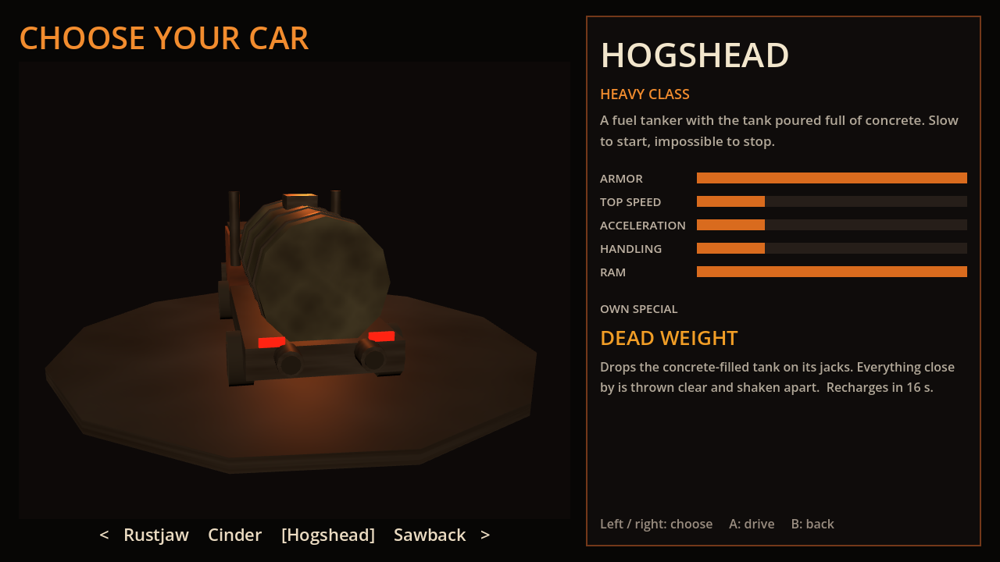

| Car | Class | Armor | Top speed | Own special |
| --- | --- | --- | --- | --- |
| **Rustjaw**: a plow-nosed coupe welded from three dead sedans | Medium | 100 | 30 m/s | **Slag Hook**: a barbed harpoon on a chain that hooks the car ahead and drags it onto your plow |
| **Cinder**: a stripped dune buggy, all roll cage and fuel cell | Light | 70 | 34 m/s | **Ember Fan**: five little rockets in a fan; each one sets a brief fire |
| **Hogshead**: a fuel tanker poured full of concrete | Heavy | 150 | 25 m/s | **Dead Weight**: drops the tank on its jacks; cars within 12 m are hurt and thrown clear |
| **Sawback**: a street sweeper with blades where the brushes were | Medium | 110 | 28 m/s | **Ripsaw**: a spinning blade that runs along the ground and bounces off walls three times |
| **Warrant**: a repo agency's armoured interceptor, light bar shot out | Medium | 90 | 31 m/s | **Spike Net**: a chain net that snags the target's wheels; its top speed drops to under a third for 2 s |
| **Bastion**: a six-wheel surplus troop carrier with a mortar tube | Heavy | 160 | 23 m/s | **Mortar Spread**: lobs five small charges in a fan over the bonnet; each bursts where it lands |
| **Mourner**: a rusted hearse with plate over the side glass | Medium | 80 | 30 m/s | **Pall**: kicks a casket out the back that bursts into black smoke; anyone inside burns and rockets lose their lock |
| **Bucketmouth**: a wheel loader with a toothed bucket | Heavy | 150 | 22 m/s | **Scoop and Hurl**: scoops the car right in front and flings it back over the cab |
| **Tonnage**: a monster truck on a mine dump-truck frame | Heavy | 140 | 24 m/s | **Rockslide**: tips the bed; four slag boulders roll out behind and flatten what they hit |
| **Vandal**: a supercharged muscle car, zip-tied together | Medium | 85 | 32 m/s | **Shrapnel Ring**: scrap blown out in every direction at once, front, back and sides |
| **Lancet**: a stripped open-wheel racer with a jet bolted on | Light | 60 | 36 m/s | **Ghost Run**: 4 s off radar and immune to lock-on, turbo topped up; firing ends it |
| **Sermon**: a street preacher's lowrider with PA horns | Medium | 90 | 29 m/s | **Hydraulic Hop**: leaps over incoming shots and slams down, hurting and shoving cars around the landing |

Each car's own special sits in the special weapon list alongside the pickups, holds one shot and
recharges on its own (12 to 16 seconds; the thin bar under the special panel). It's selected
when you start. Pick up a weapon crate and the new weapon is selected; cycle back to your own
with previous / next special, and it comes back by itself when the pickups run out. Tailgunner
fires it out the back like any other special. Slag Hook, Ember Fan and Ripsaw bend slightly toward
a target ahead, like the Firebrand.

Every car's numbers and its special live in `data/vehicles/<car>.json`, and the select screen
order in `data/roster.json`, so new cars are mostly data.

| Slag Hook | Ember Fan |
| --- | --- |
| 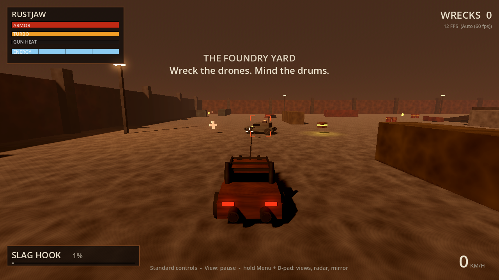 | 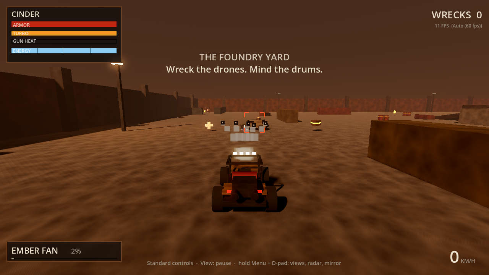 |
| **Dead Weight** | **Ripsaw** |
| 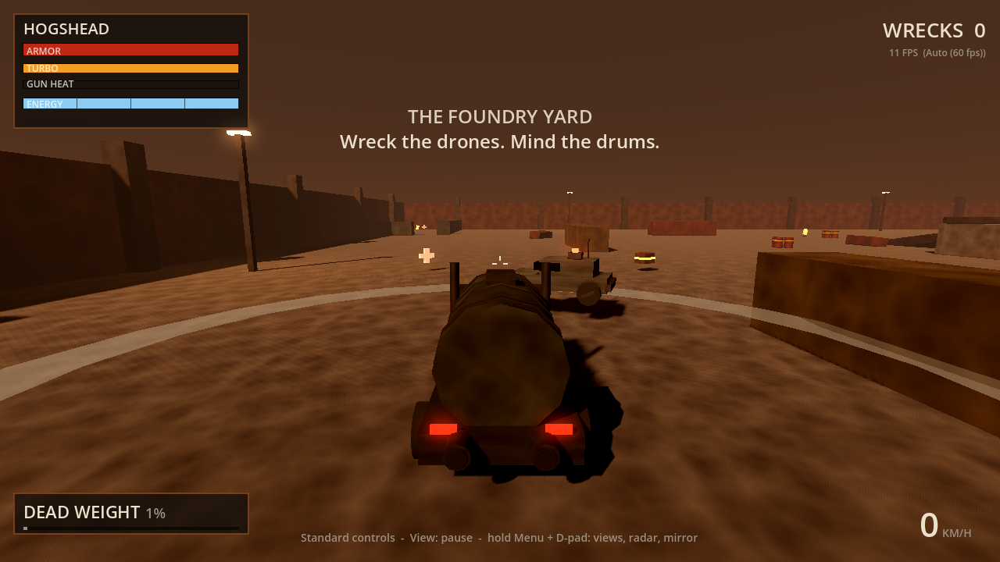 | 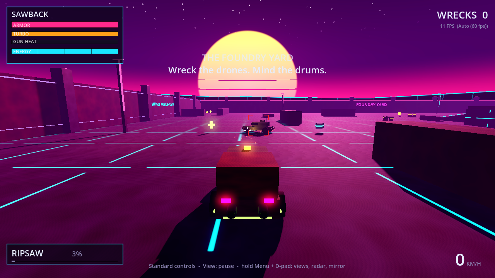 |
| **Spike Net** | **Mortar Spread** |
| 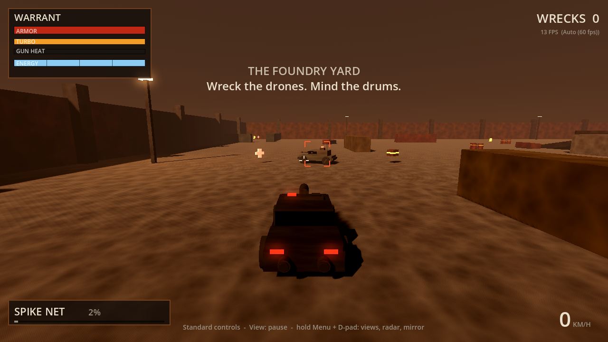 | 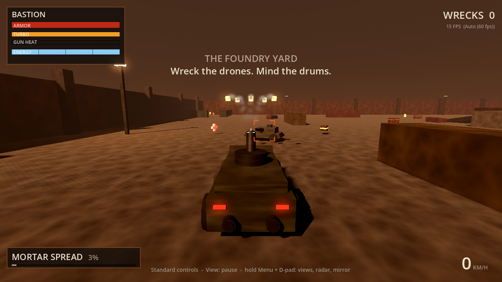 |
| **Pall** | **Scoop and Hurl** |
| 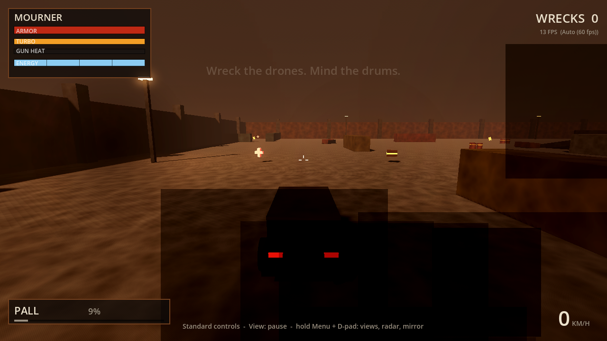 | 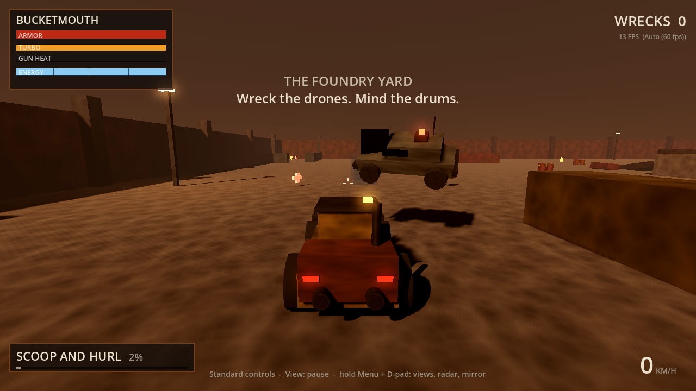 |
| **Rockslide** | **Shrapnel Ring** |
| 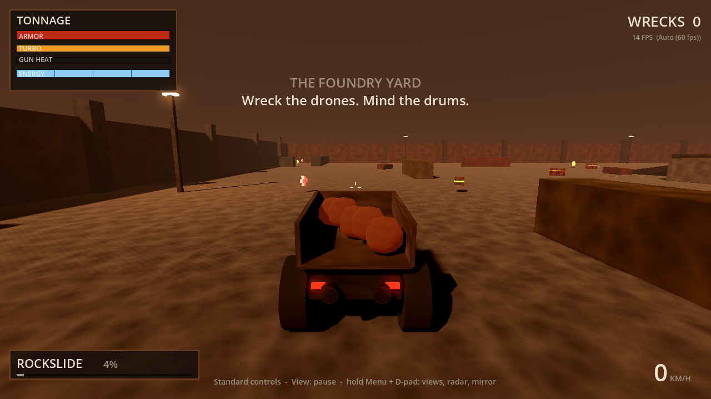 | 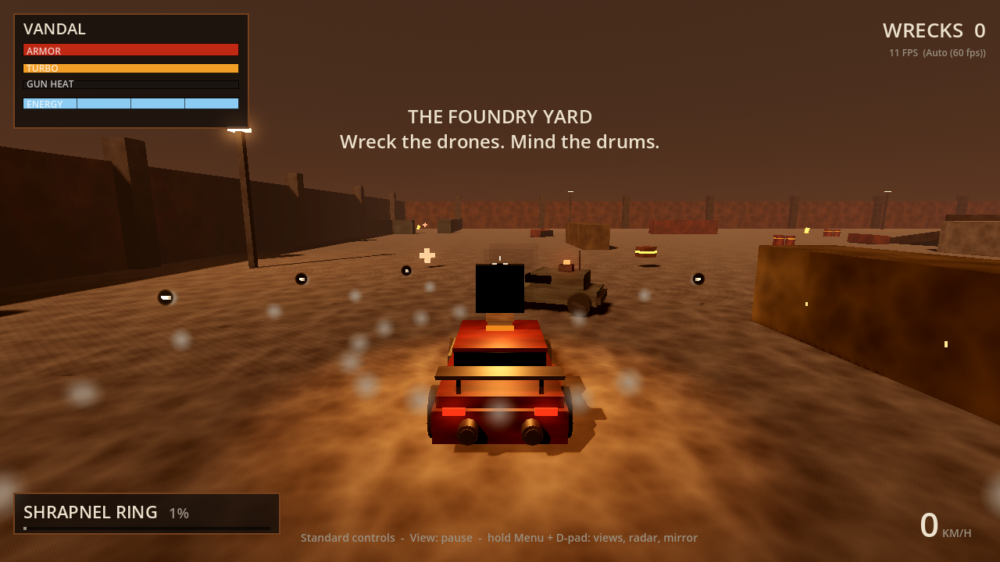 |
| **Ghost Run** | **Hydraulic Hop** |
| 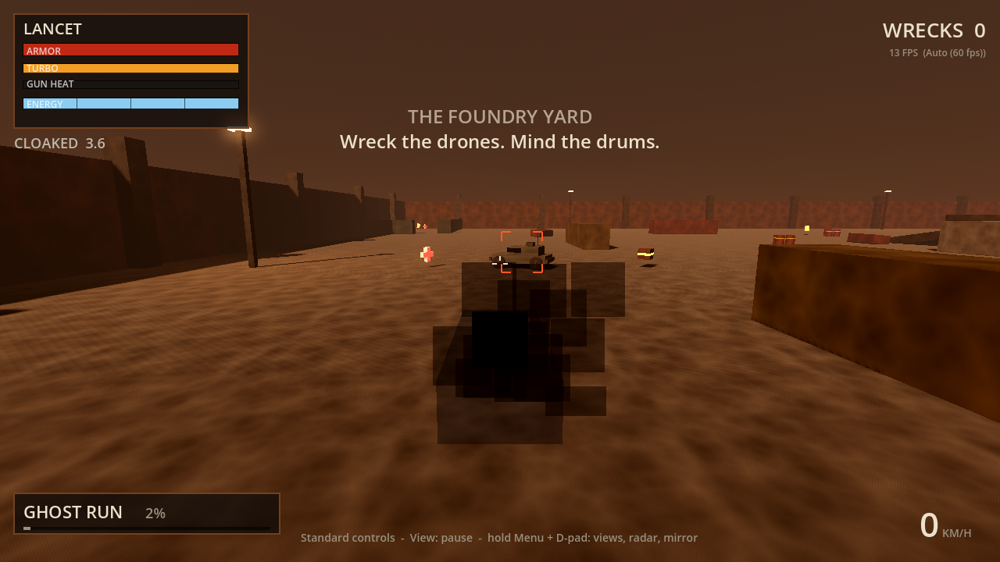 | 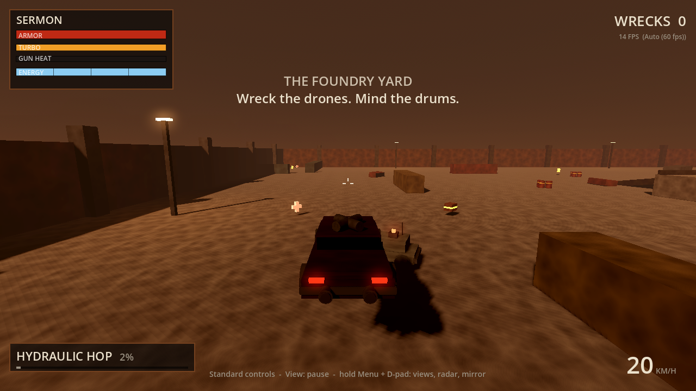 |

The select screen shows five names at a time with your place in the roster (`6 / 12`).

## Controls

Five pad layouts; switch between them in the pause menu (**Controls**). Your choice is saved.
**Standard** is the default. The first four are the classic 1990s arcade-combat pad layouts,
moved to the Xbox pad button for button (Cross = A, Circle = B, Square = X, Triangle = Y,
L1/R1 = LB/RB, L2/R2 = LT/RT, Select = View, Start = Menu). In those four **the D-pad drives**
(up is gas, down is brake, left and right steer) **and enters the combo moves**. Every action
can also be remapped (see **Remapping** below); the tables show the defaults.

| Action | Standard (default) | Alternate 1 | Alternate 2 | Shoulders |
| --- | --- | --- | --- | --- |
| Gas | X / D-pad up | A / D-pad up | A / D-pad up | RT / D-pad up |
| Brake, then reverse | B / D-pad down | LT / D-pad down | LT / D-pad down | RB / D-pad down |
| Steer | D-pad left / right (or left stick) | same | same | same |
| Turbo (rocket) | Y | Y | Y | LB |
| Tight turn | A | RT | RT | LT |
| Next special | RB | RB | RB | Y |
| Previous special | LB | LB | LB | B |
| Fire special | LT | B | X | A |
| Machine guns | RT | X | B | X |
| Combo moves | D-pad | D-pad | D-pad | D-pad |
| Combo hold (for held moves) | RT | RT | RT | RT |
| Pause | View (or tap Menu) | same | same | same |
| Change view (chase, far chase, hood) | Menu + D-pad up / down | same | same | same |
| Radar | Menu + D-pad left | same | same | same |
| Rear-view mirror | Menu + D-pad right | same | same | same |
| Enemies left | Menu + A | same | same | same |
| Look back | Right stick click | same | same | same |
| Handling tuning panel | Left stick click | same | same | same |

**Modern** is our own stick-and-trigger layout: RT gas, LT brake, left stick steers, A turbo,
B tight turn, RB machine guns, X special, LB / Y previous / next special, right stick click look
back, Menu pause, and View held with the D-pad for views, radar and mirror. The D-pad is for
combos only.

| Action | Keyboard |
| --- | --- |
| Gas / brake / steer | W, S, A, D (or the arrow keys) |
| Tight turn | X |
| Machine guns / fire special | Space / F |
| Previous / next special | Q / E |
| Turbo / look back | Shift / C |
| Combo moves / combo hold | I, K, J, L (up, down, left, right) / Ctrl |
| Change view / radar / mirror / enemies left | V / R / M / Tab |
| Pause / tuning panel / debug readout / fullscreen | Esc / F1 / F3 / F11 |

D-pad steering ramps in over a fraction of a second instead of snapping to full lock, and the
left stick also steers in every layout. While Menu is held, D-pad presses are view controls,
not combo presses (they still nudge the gas, brake or steering).

**Turbo** is a rocket. It kicks you forward the moment it lights, keeps pulling hard right up to
turbo top speed, and works in the air: hold it after a jump (or a Spring Jack) and the rockets
drive you forward and hold off the fall, so you carry much further. Flames shoot out of the two
nozzles on the back bumper while it burns, longer in the air. It uses the TURBO bar, and each
light-up costs a little extra, so tapping it isn't free.

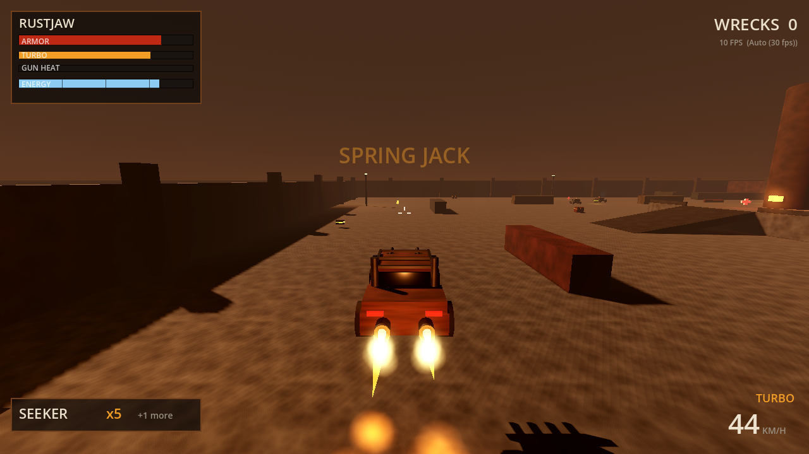

**Tight turn** swings the car round hard: hold it and steer. At full speed it whips you round
180 degrees in under a second, scrubbing off speed as it goes, so you can face whoever is
chasing you. **Power slide:** hold brake and steer at speed for a longer, looser drift.

### Combo moves

Tap a D-pad sequence quickly (each press within about half a second of the last). Each move
costs combo energy (the ENERGY bar at the bottom of the status panel), which refills on its
own. The notches on the bar are 25 energy apart. Your presses show as arrows at the bottom of
the screen while you enter them, and the pause menu lists every move.

| Move | Xbox inputs | Keyboard | Energy | What it does |
| --- | --- | --- | --- | --- |
| Scrap Mine | Right, Left, Down | L, J, K | 25 | Drops a spiked mine behind you. It blows up the next car to touch it (three out at a time). |
| Cold Snap | Left, Right, Up | J, L, I | 35 | Coolant round that freezes the car it hits for about 2 seconds. Leaves straight and bends slightly toward a target ahead. |
| Spring Jack | Up, Up, Left | I, I, J | 25 | Hydraulic jump. Hop walls, dodge mines. Ground only. |
| Rivet Storm | Hold RT + Up, Down, Left, Right, Right, Left, Down, Up | Hold Ctrl + I, K, J, L, L, J, K, I | 50 | For 4 seconds the guns fire twice as fast, hit 1.5 times harder and never overheat. |
| Fire Jug | Right, Left, Up | L, J, I | 35 | Lobs a jug of fuel ahead that leaves a burning pool. Cars in it catch fire. |
| Tailgunner | Left, Right, Down | J, L, K | 35, or a special shot | Fires your selected special weapon out the back at whoever is behind you, using one of its shots and no energy. With no special selected (or none left) it fires a freeze blast out the back for 35 energy. |
| Blackout | Right, Down, Left, Up | L, K, J, I | 40 | Black smog: for 4 seconds nothing can lock on to you, Seekers lose you and drones can't find you. Firing ends it. |
| Bulwark | Up, Up, Right | I, I, L | 50 | Force field: no damage for 3 seconds. Puts out fire and thaws ice. |

**Held moves:** Rivet Storm only works with RT held while you enter the code. Holding RT also
keeps a short code inside the long one (Right, Left, Down is in there) from dropping a mine
partway through. Short moves still work with RT held, so in the Modern layout you can keep
accelerating while you use them.

A frozen car can't drive, fire specials or use combos. The combo directions and the hold are
their own actions (Combo up/down/left/right, Combo hold), so they can be remapped like
everything else. In the D-pad layouts the same presses also drive (an Up in a code is a quick
tap of gas); only the exact sequences above fire a move, and every one has an Up or Down in it,
so steering taps alone never fire one. In Standard, RT is also the machine guns, so the guns
fire while you hold it for Rivet Storm.

Names, inputs, costs and effects all live in `data/combos.json`, so new moves can be added
there.

### Special weapons

Weapon crates (yellow band) give two shots of a random special. Hold up to six of each, switch
with previous / next special, and fire with the special button.

| Special | What it does |
| --- | --- |
| Seeker | Homing missile; follows your lock-on target. |
| Firebrand | Fast incendiary round; sets the target alight. Bends slightly toward a target ahead. |
| Sledge | Slow, heavy rocket that fires straight and shoves what it hits. |
| Satchel | Canvas bag of blasting charge. Tap to lay up to three behind you; press again a second or more later to set them all off. Left alone, they blow after 8 s. |
| Tar Pot | Lobbed canister that bursts into a wide pool of burning tar. |
| Skipper | Bomb that bounces off floors and walls up to three times, then blows; it blows at once if it hits a car. |
| Arc Coil | A bolt of current to the car ahead that jumps on to the car nearest it. Both lose their turbo for 2 s. With nobody ahead it doesn't fire. |

Their numbers live in `data/specials.json`.


### Remapping

Pause, then choose **Remap controls**. Every action has a controller column and two keyboard
columns (main and alt key). Pick a cell with the D-pad or mouse, press **A** / **Enter**, then
press the new button, trigger, stick direction or key. If another action already used it, the two
swap, so nothing is ever left doubled up. **Backspace** clears a key; **Esc**, or waiting five
seconds, cancels. Controller remaps are kept separately for each layout, and keyboard
remaps apply to both. **Reset to defaults** (press twice) restores the current layout and the
keyboard. Everything is saved to `user://settings.cfg` straight away.

Analog steering follows whatever stick is bound to Steer left / right, so you can move steering
to the right stick.


## What's new in Iron Carnage update 2

- **Three new arenas**, picked on the new match setup screen:

  | Arena | What's there |
  | --- | --- |
  | **Refinery Row** | Burning flare stacks in the corners, two tank farms, a pipe bridge 4 m up down the middle with ramps at both ends, fuel drums everywhere. |
  | **Frozen Wharf** | An iced-over harbour. The north half is sheet ice where cars slide; a beached freighter lies across it with ramps up to its deck. Container canyons and dead cranes on the pier. Snow. |
  | **Blackwater Bog** | Swamp at night. Sucking mud pools hold cars to about half speed; a boardwalk on stilts loops the middle; dead trees, a stilt shack, a sunken bus. |

  | Refinery Row | Frozen Wharf |
  | --- | --- |
  | 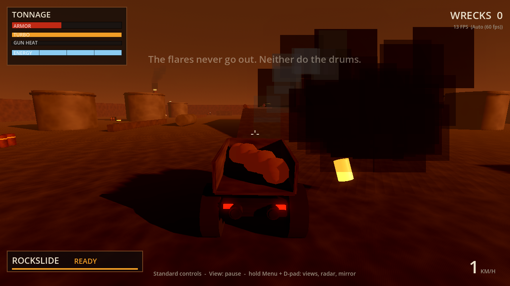 | 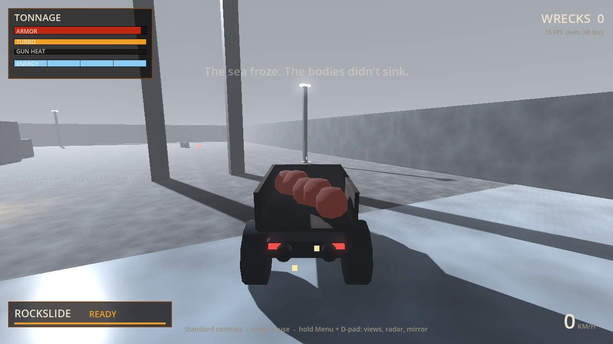 |
  | **Blackwater Bog** | **Match setup** |
  | 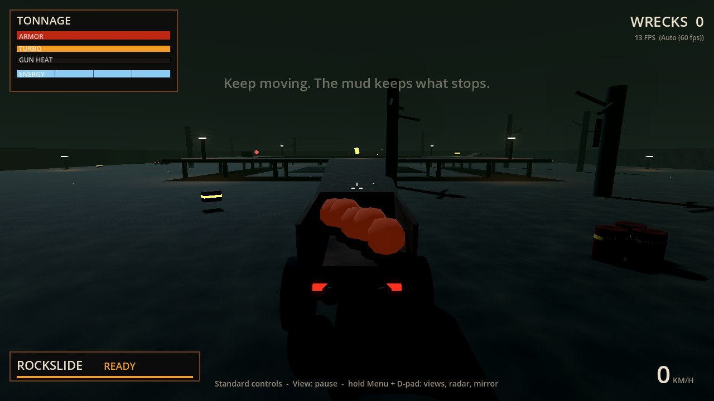 | 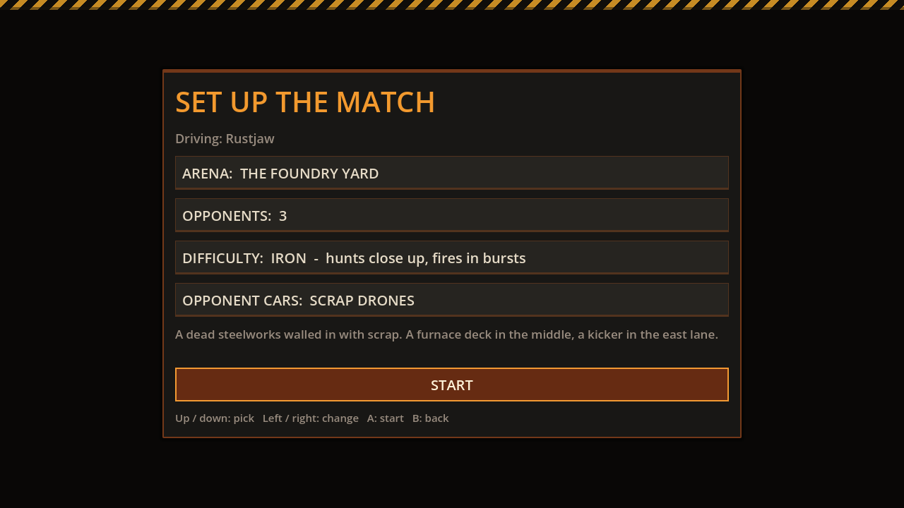 |

- **Bot difficulty**: **Scrap** (slow to notice you, poor shots), **Iron** (the old behaviour) and
  **Carnage** (hunts from across the arena, uses turbo, fires weapons and specials more).
- **Opponents in roster cars**: bots can drive any of the twelve cars (never yours) and use
  their own specials and pickup weapons, aimed the right way (rear drops when you're behind,
  close-range specials when you're close).
- **1 to 6 opponents.**
- **Ice and mud**: a car on ice keeps most of its slide; mud cuts top speed to about half
  (three quarters with turbo).
- The pause menu's **Change car or arena** goes back through car select and match setup.

## What's new in Iron Carnage update 1

- **Renamed** to Iron Carnage everywhere: window, title screen, save folder, shortcut.
- **The gritty look is back.** The Neon Wasteland pass is gone; the Foundry Yard is soot, rust and
  sodium lamps again. The title screen is a stencilled steel plate between strips of hazard
  tape, and menus are steel plates with a hazard-amber lip.
- **Eight new cars**: Warrant, Bastion, Mourner, Bucketmouth, Tonnage, Vandal, Lancet and Sermon,
  each with its own special (see **Cars**). The select screen and HUD handle the bigger roster.
- **Four new pickup weapons** in weapon crates: Satchel, Tar Pot, Skipper and Arc Coil.
- **New status effects**: SNARED (Spike Net) and TURBO DEAD (Arc Coil), shown on the HUD.
- **Grip handling preset**: in the tuning panel, **Grip** makes the car stop quicker off the
  throttle, slide less and straighten faster. **Save** keeps it; **Reset** undoes it.

Next up: the Gauntlet campaign through the arenas, The Assessor boss, a tally screen after
each round.

## What's in Milestone 2

- **Four cars**, each with its own recharging special, and a car select screen (see **Cars**).
- **Eight combo moves** on the D-pad with an energy meter, including a held long code (see above).
- **Three special weapons** from weapon crates, with ammo per weapon and cycling.
- **Status effects**: shielded, frozen, burning, cloaked and Rivet Storm, shown on the car and
  on the HUD.
- **Rocket turbo**: a nitrous kick, a push that doesn't fade, thrust in the air, and flames out
  the back.
- **Weapons curve slightly**: Firebrand, Cold Snap and the Tailgunner shots bend gently toward a
  target in front of them. The Sledge flies dead straight and the Seeker still homes.
- **Scrap Drones fight back**: they hunt you when you're close, fire their guns in bursts,
  drop mines or fire a Tailgunner round when you chase them, raise Bulwark when hurt, and throw
  Cold Snaps. They lose you while you're under Blackout.

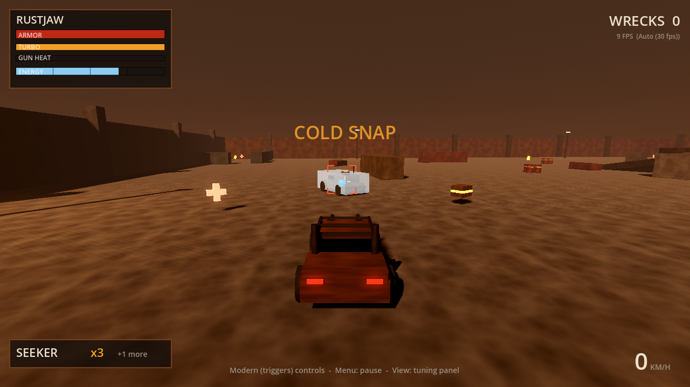

## What's in Milestone 1

- **Rustjaw**, a plow-nosed coupe, with raycast suspension and our own arcade handling model.
- **The Foundry Yard**, a 160 m walled steelworks: a raised furnace deck with ramps, container
  cover, a kicker jump in the east lane, fuel drums that explode, and a hidden pocket in the
  north-west corner.
- **Twin Rivet Guns** with unlimited ammo and an overheat bar, light aim assist and a lock-on
  bracket.
- **Scrap Drones**: driverless cars that lap the yard.
- **Pickups**: Patch Kits (armor), Nitro Cans (turbo) and, from Milestone 2, weapon crates.
- **Ram damage** from hard hits, rumble on big hits, wreck and respawn.
- **Frame rate**: physics always runs at 60 Hz. Display is Auto (60, dropping to a steady 30 on
  slower machines), 30, or 60. Graphics presets Low, Medium, High.
- **Tuning panel** (View button) to change handling numbers live, save them, or copy them out.

## Tuning the handling

Open the tuning panel with **View**. Pick a number with the D-pad, change it with left/right,
close with **B**, and drive. **Save** keeps your numbers in your user folder for next time; **Copy**
puts them on the clipboard so they can go into `data/vehicles/rustjaw.json` for everyone.
See [docs/FEEL_TUNING.md](docs/FEEL_TUNING.md) for what each number does and how to tune by feel.

The current measured numbers are in [docs/handling_report.md](docs/handling_report.md).

## Tests

```sh
godot --headless --path . --import
godot --headless --path . --fixed-fps 60 --script res://tests/run_tests.gd
```

The suite checks the rules (damage, heat, pickups, input layouts, remapping, combo recognition,
energy and status effects), measures the handling on a test pad against
`data/handling_targets.json`, fires every combo move and a special on the test pad, and runs a
smoke test in the arena (drones keep lapping, drones hunt and damage the player, the gun wrecks a
drone, pickups heal). It rewrites `docs/handling_report.md`.

## Project layout

| Folder | What lives there |
| --- | --- |
| `core/` | Engine-agnostic rules: handling model, combat rules, combo recognition, status effects, stats, data loading |
| `data/` | Vehicles, weapons, combo moves, specials, pickups and handling targets as JSON |
| `game/` | Godot layer: vehicle body, camera, input, arena, UI, audio, effects |
| `assets/audio/` | Placeholder sounds and music (regenerate with `tools/make_placeholder_audio.py`) |
| `tests/` | Headless test suite |
| `tools/` | Placeholder audio generator, screenshot tool |
| `docs/` | Architecture, Unreal port notes, tuning guide, handling report, screenshots |

See [docs/ARCHITECTURE.md](docs/ARCHITECTURE.md) for how the pieces fit and how the Unreal
port would work.

## Exporting

Add export templates in Godot (Editor > Manage Export Templates), then Project > Export.
In each preset, set **Resources > Filters to export non-resource files** to `data/*.json`
so the game data ships with the build.

- **Windows / Linux / Steam Deck:** standard desktop presets.
- **iPad:** needs a Mac with Xcode and an Apple developer account. Xbox controllers pair with
  iPad over Bluetooth and work in-game. Touch controls are not in this build. The Mobile
  renderer and Low graphics preset are meant for iPad.

## Placeholders

Every model, texture, sound and the music loop in this build is a placeholder generated in
code. Official art and audio will replace them; the vehicle and arena code doesn't depend on
the placeholder shapes.
